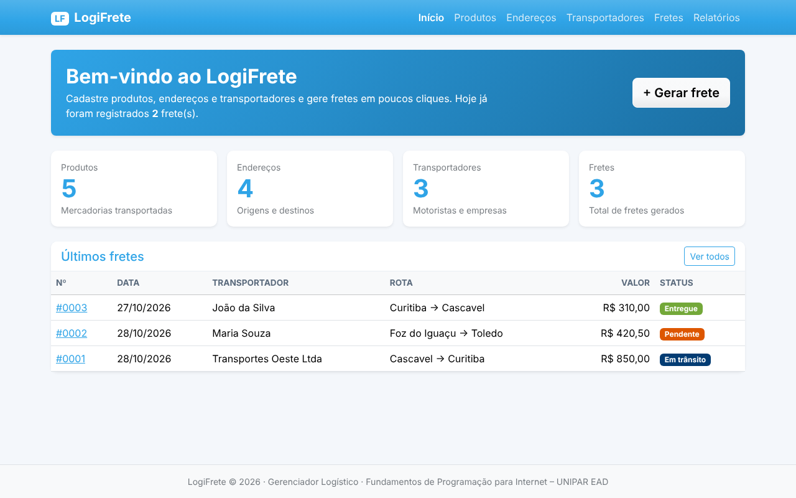
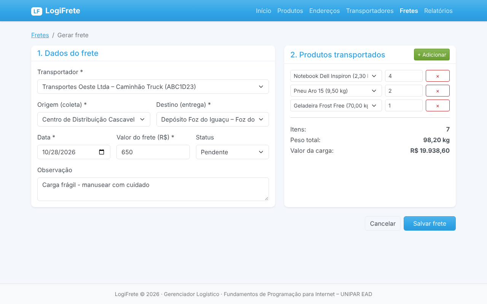
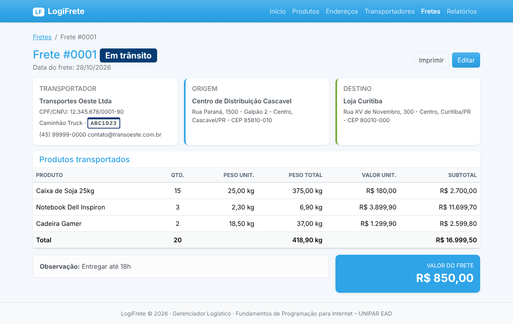
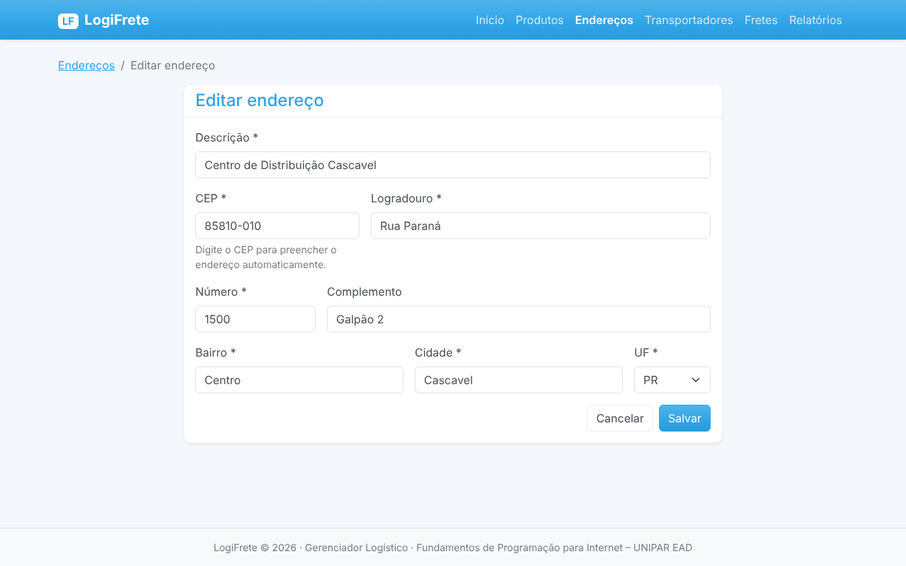
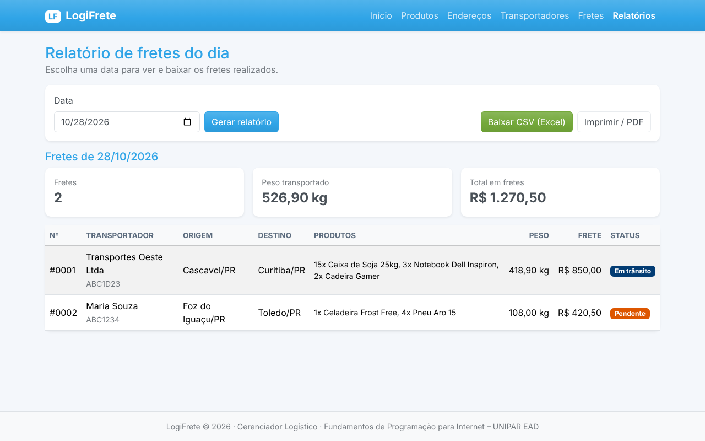

# LogiFrete – Gerenciador Logístico em PHP

Sistema web para gerenciar **fretes**: cadastro de produtos, endereços de origem e destino e transportadores, com geração de fretes em que **um transportador leva vários produtos** (relação 1 para muitos) e download de relatório dos fretes de um dia.

Projeto desenvolvido para a Atividade Prática Orientada (APO) da disciplina **Fundamentos de Programação para Internet** – UNIPAR EAD.



## Funcionalidades

- **Produtos**: cadastro, edição, busca e exclusão (nome, descrição, peso e valor).
- **Endereços**: cadastro e edição de origens e destinos, com **preenchimento automático pelo CEP** (API ViaCEP).
- **Transportadores**: cadastro e edição com CPF ou CNPJ, telefone, e-mail, veículo e placa (máscaras em JavaScript).
- **Fretes**: liga um transportador, uma origem e um destino a **vários produtos**. As linhas de produtos são adicionadas e removidas dinamicamente com JavaScript, com cálculo do peso e do valor da carga em tempo real.
- **Relatório do dia**: lista os fretes de uma data e permite **baixar em CSV** (abre no Excel) ou imprimir/salvar em PDF.
- Validações no servidor (PHP) e no navegador, mensagens de sucesso/erro e proteção contra exclusão de registros em uso.

## Tecnologias

| Camada | Tecnologia |
|---|---|
| Backend | PHP 8 com PDO (prepared statements) |
| Banco de dados | MySQL / MariaDB (XAMPP) |
| Frontend | HTML5, CSS3 e JavaScript |
| Visual | Bootstrap 5.3 (tema Cerulean do Bootswatch, incluído localmente) |
| Versionamento | Git e GitHub |

## Estrutura de pastas

```
logifrete/
├── index.php              # Painel inicial
├── config/
│   └── database.php       # Conexão com o banco (PDO)
├── includes/
│   ├── init.php           # Sessão, configuração e funções (incluído em todas as páginas)
│   ├── header.php         # Cabeçalho e menu de navegação
│   ├── footer.php         # Rodapé e scripts
│   ├── funcoes.php        # Formatação de dados: moeda, datas, CPF/CNPJ, CEP, telefone
│   └── relatorio.php      # Consulta dos fretes do dia
├── produtos/              # index (lista), form (cadastro/edição), excluir
├── enderecos/             # index, form, excluir
├── transportadores/       # index, form, excluir
├── fretes/                # index, form (geração), ver (detalhes), excluir
├── relatorios/            # index (relatório do dia), download (CSV)
├── assets/
│   ├── css/style.css
│   ├── js/app.js          # Campos dinâmicos, ViaCEP, máscaras, confirmações
│   └── vendor/bootstrap/
├── sql/banco.sql          # Criação do banco + dados de exemplo
└── docs/telas/            # Telas do sistema
```

## Modelo de dados

```
transportadores 1 ──── N fretes N ──── 1 enderecos (origem)
                             │  N ──── 1 enderecos (destino)
                             │
                             1
                             │
                             N
                      frete_produtos N ──── 1 produtos
```

A tabela `frete_produtos` guarda os itens de cada frete (produto e quantidade), permitindo que um único transportador leve vários produtos em um frete.

## Como executar (XAMPP)

1. Instale o [XAMPP](https://www.apachefriends.org/pt_br/index.html) e inicie o **Apache** e o **MySQL** no painel.
2. Copie (ou clone) a pasta do projeto para `C:\xampp\htdocs\logifrete`:
   ```bash
   cd C:\xampp\htdocs
   git clone https://github.com/SEU-USUARIO/logifrete.git
   ```
3. Acesse `http://localhost/phpmyadmin`, abra a aba **SQL**, cole o conteúdo de `sql/banco.sql` e clique em **Executar**.
4. Abra `http://localhost/logifrete` no navegador.

A conexão usa o padrão do XAMPP (usuário `root`, sem senha). Para alterar, edite `config/database.php`.

## Telas

| Gerar frete | Detalhe do frete |
|---|---|
|  |  |

| Cadastro de endereço | Relatório do dia |
|---|---|
|  |  |

## Autor

**Tasso Rodrigues** – Análise e Desenvolvimento de Sistemas, UNIPAR EAD.

## Referências

- PHP. Manual do PHP. Disponível em: https://www.php.net/manual/pt_BR/
- W3SCHOOLS. HTML, CSS, JavaScript and PHP Tutorials. Disponível em: https://www.w3schools.com
- BOOTSTRAP. Documentação do Bootstrap 5. Disponível em: https://getbootstrap.com/docs/5.3/
- VIACEP. Webservice gratuito de consulta de CEP. Disponível em: https://viacep.com.br
- CHACON, S.; STRAUB, B. Pro Git. 2. ed. Disponível em: https://git-scm.com/book/pt-br/v2
